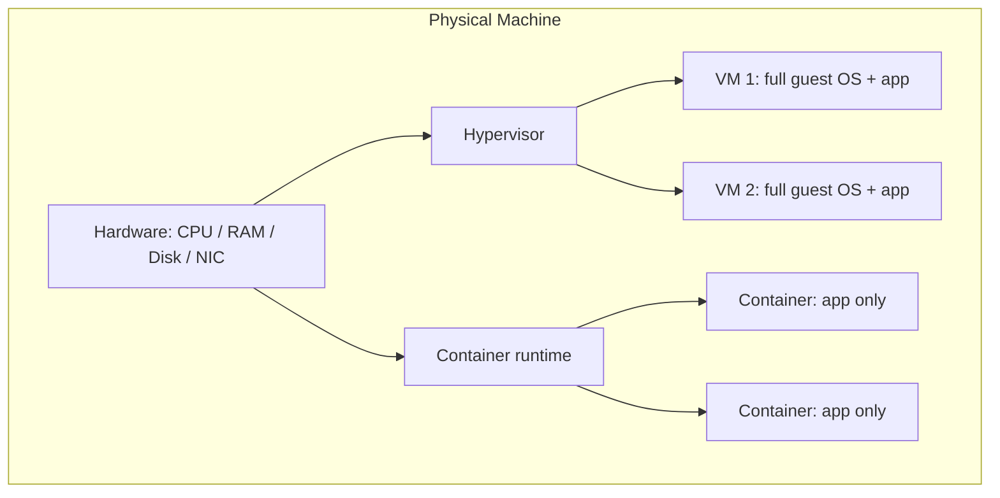
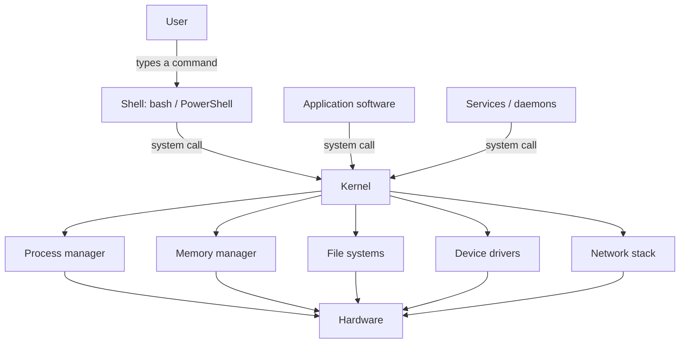
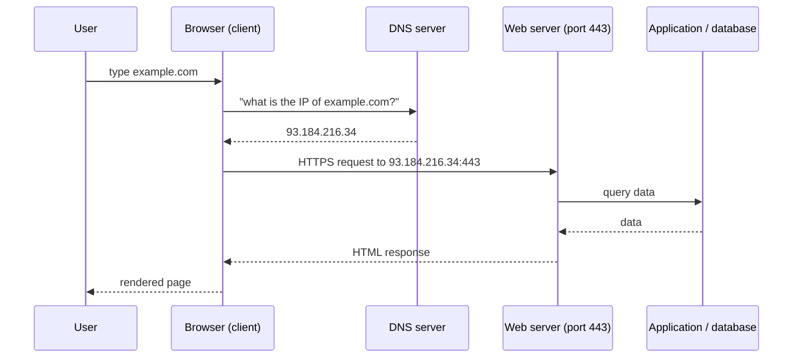
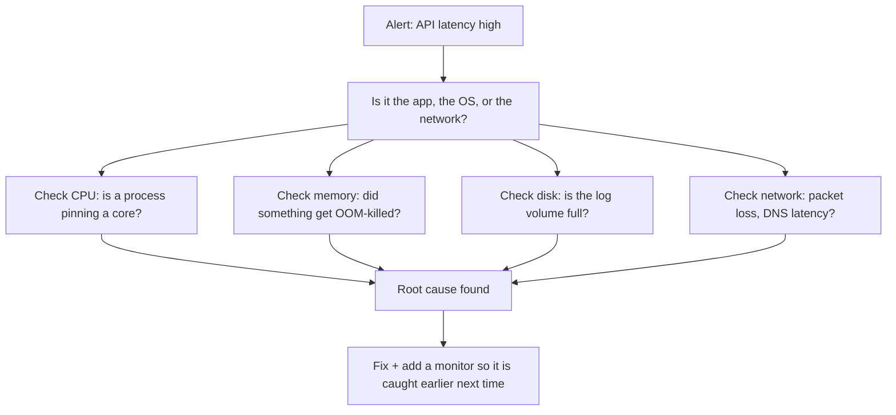

# Day 001 — Computer Fundamentals and Operating Systems

**Level:** 1 — Foundations
**Week:** 1 · **Day:** 1
**Date studied:** 2026-10-13
**Estimated study time:** 2–3 hours (1 hour reading, 1–2 hours lab + assignment)

**Related topics:** Day 002 (Windows vs Linux, boot process) · Day 003 (Files, directories,
processes, memory in depth) · Day 00X (Linux installation with WSL)

---

## 1. Learning Objectives

By the end of this lesson I should be able to:

1. Explain in simple words what a computer is, in terms of **hardware** and **software**.
2. Define an **operating system (OS)** and explain the problem it solves.
3. Name the four main hardware resources an OS manages: **CPU, memory, storage, network**.
4. Explain the difference between a **program**, a **process**, and a **service/daemon**.
5. Describe the **kernel** and the **shell**, and how they differ.
6. Distinguish **system software** from **application software**, and **firmware/BIOS/UEFI**.
7. Explain the **client–server** model with a real example.
8. Explain what **virtualization** is and how a **virtual machine** differs from a **container** (at a high level).
9. Use basic Windows/PowerShell commands to inventory my own machine: OS version, CPU, RAM, disk, processes.
10. Read that output and say what each number means.

---

## 2. Prerequisites

**This is a beginner-friendly topic.** No prior DevOps, Linux, or networking knowledge is required.

The only prerequisite is that I have a computer and I am willing to open a terminal and type commands.

---

## 3. Introduction

### The office analogy

Think of a computer as an **office building**.

| Building thing | Computer equivalent |
|---|---|
| Workers doing tasks | **CPU** (Central Processing Unit) |
| Desks where workers keep current paperwork | **RAM** (memory) |
| Filing cabinets that keep papers permanently | **Disk / storage** (SSD or HDD) |
| Mail room, phone lines | **Network card** (NIC) |
| The building manager who decides who uses which room | **Operating system** |
| The reception desk where you submit requests | **Shell / terminal** |
| Machinery permanently installed in the walls | **Firmware / BIOS / UEFI** |
| The actual people who come to work each day | **Processes** |

A computer is useless without someone deciding **who gets the CPU next, who gets memory,
who is allowed to read which file, and who may use the network**. That "someone" is the
**operating system**.

Without an OS, a program would have to speak directly to the hardware and would break
the moment the hardware changed. With an OS, programs ask the OS for things ("give me
memory", "write this file") and the OS handles the hardware details.

---

## 4. Why Do We Need It?

### The problem before operating systems

In the 1940s–50s, computers had no operating systems. To run a program you literally
rewired the machine or loaded punched cards. Only one program ran at a time, and humans
had to babysit the machine.

Problems:

1. **One program at a time.** The expensive CPU sat idle while a card reader worked.
2. **No protection.** A buggy program could overwrite another program's memory, or crash the machine.
3. **No sharing.** Multiple users could not use the machine.
4. **No abstraction.** Every program had to know the exact hardware details.
5. **No file system.** Data was stored wherever the programmer decided.

### What the OS solves

| Problem | OS solution |
|---|---|
| CPU idle while waiting for I/O | **Process scheduling** — switch between tasks quickly |
| Programs overwrite each other | **Memory isolation / virtual memory** |
| Many users, one machine | **Users, permissions, multi-user support** |
| Hardware differences | **Device drivers + system calls (API)** |
| Finding data again | **File systems** (NTFS, ext4, XFS…) |
| Cables and cards differing per machine | **Device drivers** |
| Security | **Authentication, permissions, logging** |
| Networking | **TCP/IP stack built into the OS** |

**One-sentence definition to remember:**

> An operating system is the software layer that sits between the user/applications and
> the hardware, and manages CPU, memory, storage, devices, users, and networking so that
> programs can run safely and efficiently.

---

## 5. Core Concepts

### 5.1 Hardware (the physical parts)

| Component | What it does | DevOps relevance |
|---|---|---|
| **CPU** | Executes instructions. Has **cores** (independent workers) and **threads** (logical workers). | Determines how many containers/pods a node can host. |
| **RAM** | Fast temporary workspace. Contents are lost on power off. | The #1 cause of a process being killed (OOM). |
| **Disk (SSD/HDD)** | Permanent storage. | Where images, logs, and databases live. Speed matters a lot. |
| **Motherboard / bus** | Connects the parts. | Rarely relevant. |
| **NIC** | Network Interface Card — how the machine talks to the network. | VMs and containers have virtual NICs. |
| **GPU** | Specialised parallel processor. | Relevant later for AI workloads. |

**Important distinctions:**

- **32-bit vs 64-bit:** 32-bit systems can address only ~4 GB of RAM. Modern servers are 64-bit. Ubuntu/AWS AMIs today are `x86_64` (Intel/AMD) or `arm64` (Graviton).
- **Physical cores vs logical processors (hyper-threading):** a 16-core CPU reporting 22 logical processors means some cores run two threads each.
- **SSD vs HDD:** SSD has no moving parts; random reads are orders of magnitude faster. Databases and Kubernetes etcd care enormously about this.

### 5.2 Software (the instructions)

```
Firmware (BIOS/UEFI)      <- baked into the motherboard
        |
Operating system (kernel + system libraries + tools)
        |
System services / daemons  <- run in the background (sshd, nginx, dockerd)
        |
Application software       <- what the user runs (browser, your app)
```

- **Firmware / BIOS / UEFI:** the very first code that runs when you press the power button. It finds the disk and loads the bootloader. UEFI is the modern replacement for BIOS.
- **Kernel:** the core of the OS. Talks to hardware, schedules processes, manages memory.
- **Shell:** a program that reads your typed commands and asks the kernel to do things (`bash`, `zsh`, `PowerShell`).
- **Daemon / service:** a long-running background program with no visible window (Linux calls it a *daemon*, Windows calls it a *service*).

### 5.3 The kernel vs the shell — do not confuse them

| | Kernel | Shell |
|---|---|---|
| What is it? | Core of the OS, always running | A user-facing command interpreter |
| Who uses it? | Programs, through system calls | Humans, by typing commands |
| Example | Linux kernel 6.x, Windows NT kernel | `bash`, `zsh`, `PowerShell`, `cmd.exe` |
| Can you replace it? | Only by rebooting into a different OS | Yes — just open a different shell |

```
You type:  ls -l /var/log
   |
   v
Shell parses the line, finds the program "ls"
   |
   v
Shell asks the KERNEL to start that program (fork/exec system calls)
   |
   v
Kernel gives the program CPU time, memory, and file access
   |
   v
Output comes back to your terminal
```

### 5.4 Program vs Process vs Service

| Term | Meaning | Analogy |
|---|---|---|
| **Program** | A file on disk containing instructions (e.g. `nginx.exe`, `/usr/sbin/sshd`) | A recipe in a book |
| **Process** | A *running* instance of a program, with its own memory and a **PID** | Actually cooking the recipe |
| **Service / daemon** | A background process with no interactive window, often started at boot | A full-time employee who never leaves |

One program can start **many** processes (e.g. two Chrome windows = many Chrome processes).

### 5.5 OS responsibilities (the six jobs)

1. **Process management** — create, schedule, pause, and kill processes; give each a PID.
2. **Memory management** — hand out RAM, isolate processes, use disk as "swap" when RAM is full.
3. **File system management** — organise data into files and directories with permissions.
4. **Device management** — talk to disks, keyboards, NICs via drivers.
5. **User and security management** — users, groups, permissions, auditing.
6. **Networking** — the TCP/IP stack, ports, sockets, firewall.

### 5.6 Types of operating systems

| Type | Examples | Notes |
|---|---|---|
| Desktop | Windows 11, macOS, Ubuntu Desktop | GUI-first, one human user |
| **Server** | Ubuntu Server, RHEL, Windows Server | No GUI, optimised for uptime |
| Mobile | Android, iOS | Linux/Unix kernels underneath |
| Embedded | Embedded Linux, FreeRTOS | Routers, cars, IoT |
| Real-time (RTOS) | VxWorks, FreeRTOS | Guaranteed response time |

**You will spend your DevOps career on server operating systems, mostly Linux.**

### 5.7 Client–server architecture

```
        request  -------->
Client  ------------------>  Server
        <--------  response
```

- **Client:** asks for something (browser, `curl`, mobile app, another service).
- **Server:** listens, processes, and replies (web server, API, database).

Key facts:
- The server **listens on a port** (e.g. HTTPS on 443, SSH on 22).
- One server can serve thousands of clients at once.
- "Server" can mean **hardware** ("a server in the rack") or **software** ("an nginx server"). Context tells you which.

### 5.8 Virtualization and containers (preview)

| | Physical machine | Virtual machine (VM) | Container |
|---|---|---|---|
| What it is | Real hardware | Emulated hardware + full guest OS | Isolated process on a shared kernel |
| Guest OS | one | full OS per VM | none (shares host kernel) |
| Size | — | GBs | MBs |
| Boot time | minutes | ~30–60 s | < 1 s |
| Isolation | strongest | strong | good, not as strong as VM |
| Managed by | — | Hypervisor (VMware, KVM, Hyper-V) | Container runtime (Docker, containerd) |



**Why this matters in DevOps:** cloud instances are VMs, Kubernetes nodes are usually VMs,
and your applications run inside containers. Understanding the layers helps you debug
"where did the memory actually go?".

---

## 6. Architecture / Workflow

### 6.1 The layered view of a running system



### 6.2 What happens when you open a web page (end-to-end preview)



Do not worry if DNS/TLS/ports are unfamiliar — they are Days 30+ topics. The point today
is that **your OS on both sides is doing all of this work**.

---

## 7. Commands and Code

### Where to run these

Open **Windows Terminal** (or VS Code → Terminal) and make sure it says **PowerShell**.
Commands below are read-only and safe.

> ⚠️ **All sample output shown below is illustrative** — it was captured from one specific
> machine. Your numbers *will* be different. What matters is that you can explain each value.

---

### 7.1 Which OS am I on?

```powershell
[System.Environment]::OSVersion.Version
```

**What it does:** prints the OS version number.
**Expected output (illustrative):**

```
Major  Minor  Build  Revision
-----  -----  -----  --------
10     0      26200  0
```

**How to read it:** Windows 11 reports itself as version `10.0.<build>`.
**Verify success:** you see a version table, not an error.
**Common error:** running inside `cmd.exe` and getting `'[System.Environment]' is not recognized` → you are in the wrong shell, or you omitted `::` / used a single dot. Switch to PowerShell.

---

### 7.2 OS name, version, and architecture

```powershell
Get-CimInstance Win32_OperatingSystem |
  Select-Object Caption, Version, OSArchitecture, LastBootUpTime
```

**Breakdown:**
- `Get-CimInstance` — asks Windows' management database (WMI/CIM) for information.
- `Win32_OperatingSystem` — the class describing the OS.
- `Select-Object` — shows only the properties we care about.
- `LastBootUpTime` — when the machine last started; tells you the uptime.

**Expected output (illustrative):**

```
Caption        : Microsoft Windows 11 Pro
Version        : 10.0.26200
OSArchitecture : 64-bit
LastBootUpTime : 13/10/2026 07:41:12
```

**Verify success:** `OSArchitecture` should say `64-bit` on any modern machine.

---

### 7.3 CPU: name, cores, logical processors

```powershell
Get-CimInstance Win32_Processor |
  Select-Object Name, NumberOfCores, NumberOfLogicalProcessors
```

**Expected output (illustrative):**

```
Name                      : Intel(R) Core(TM) Ultra 7 155H
NumberOfCores             : 16
NumberOfLogicalProcessors : 22
```

**How to read it:** 16 physical cores, 22 logical processors → some cores are
hyper-threaded. More cores/threads = more parallel work, but heavier workloads (like
builds) may still be limited by RAM or disk.

---

### 7.4 Total RAM

```powershell
$ramGB = (Get-CimInstance Win32_ComputerSystem).TotalPhysicalMemory / 1GB
[math]::Round($ramGB, 1)
```

**Breakdown:**
- `TotalPhysicalMemory` is returned in **bytes**.
- Dividing by `1GB` converts to gigabytes.
- `[math]::Round(x, 1)` rounds to one decimal place.

**Expected output (illustrative):**

```
15.5
```

> **Note:** the number is smaller than the "16 GB" on the box — the OS, integrated GPU,
> and firmware reserve some memory. That is normal, not a bug.

---

### 7.5 CPU and memory usage right now

```powershell
Get-CimInstance Win32_Processor | Select-Object LoadPercentage
$os = Get-CimInstance Win32_OperatingSystem
[math]::Round((1 - $os.FreePhysicalMemory / $os.TotalVisibleMemorySize) * 100, 1)
```

**How to read it:** the first value is current CPU load (%). The second computes used
memory (%). `FreePhysicalMemory` and `TotalVisibleMemorySize` are in **kilobytes**, but
since we divide them, the units cancel out.

---

### 7.6 Disks: size, free space, file system

```powershell
Get-Volume | Where-Object DriveLetter |
  Select-Object DriveLetter, FileSystemType,
                @{n='SizeGB'; e={[math]::Round($_.Size/1GB,1)}},
                @{n='FreeGB'; e={[math]::Round($_.SizeRemaining/1GB,1)}}
```

**Breakdown:**
- `Get-Volume` lists storage volumes.
- `Where-Object DriveLetter` removes system/hidden volumes with no letter.
- `@{n='...'; e={...}}` is a **calculated property** — it creates a new column whose value is computed from the object.

**Expected output (illustrative):**

```
DriveLetter FileSystemType SizeGB FreeGB
----------- -------------- ------ ------
D           NTFS            467.8  112.2
C           NTFS            483.1  112.4
```

**File system types:** `NTFS` (Windows), `ext4`/`xfs`/`btrfs` (Linux), `APFS` (macOS),
`FAT32`/`exFAT` (USB sticks). Linux **cannot** read ext4 on Windows natively — relevant
later when you mount disks into WSL.

---

### 7.7 Processes: count and biggest memory users

```powershell
(Get-Process).Count

Get-Process |
  Sort-Object WS -Descending |
  Select-Object -First 5 Name, Id, @{n='MemMB'; e={[math]::Round($_.WS/1MB,1)}}
```

**Breakdown:**
- `Get-Process` returns one object per **process**.
- `WS` = **Working Set**, the physical RAM currently used by that process, in bytes.
- `Sort-Object WS -Descending` sorts biggest first.
- `Id` is the **PID** — the number you need if you ever have to kill a process.

**Expected output (illustrative):**

```
Name               Id  MemMB
----               --  -----
Code            44708 1064.8
Code            20344  510.1
Code            11668  447.0
chrome          37372  357.3
ChatGPT Classic 38072  310.7
```

**How to read it:** the same name (`Code`) appears many times with different PIDs —
proof that one program can create many processes.

---

### 7.8 Where is your laptop on the network?

```powershell
ipconfig
Get-NetIPAddress -AddressFamily IPv4 | Select-Object InterfaceAlias, IPAddress
```

**How to read it:** addresses starting `192.168.`, `10.`, or `172.16–31.` are **private**
addresses (only valid inside your home/office network). `127.0.0.1` is **localhost** — "this
machine itself".

> 🔐 **Security note:** never paste your public IP together with open ports on the internet,
> and never share `ipconfig /all` publicly — it can reveal your MAC address and network topology.

---

### 7.9 Services (background daemons)

```powershell
Get-Service | Where-Object Status -eq 'Running' | Select-Object -First 10 Name, DisplayName
(Get-Service).Count
```

**How to read it:** these are **services/daemons** — long-running background programs.
On Linux you will manage the exact same concept with `systemctl`.

---

## 8. Practical Lab

**Full lab sheet:** [labs/day-001/lab-01-machine-inventory.md](../../labs/day-001/lab-01-machine-inventory.md)

### Objective
Build a one-page "machine inventory" of your own computer by running read-only commands
and *explaining* every number in the report.

### Requirements
- Windows 11 with Windows Terminal (or VS Code integrated terminal)
- Basic ability to copy/paste into a terminal

### Steps

1. Open **Windows Terminal → PowerShell**.
2. Create your lab folder:

   ```powershell
   New-Item -ItemType Directory -Force -Path "d:\vip\Learn\DevOps\devops-learning\labs\day-001\output" | Out-Null
   ```

3. Run each of these and save the output to files:

   ```powershell
   $out = "d:\vip\Learn\DevOps\devops-learning\labs\day-001\output"
   Get-CimInstance Win32_OperatingSystem | Select-Object Caption, Version, OSArchitecture, LastBootUpTime | Out-File "$out\os.txt"
   Get-CimInstance Win32_Processor | Select-Object Name, NumberOfCores, NumberOfLogicalProcessors | Out-File "$out\cpu.txt"
   (Get-CimInstance Win32_ComputerSystem).TotalPhysicalMemory / 1GB | Out-File "$out\ram-gb.txt"
   Get-Volume | Where-Object DriveLetter | Select-Object DriveLetter, FileSystemType, Size, SizeRemaining | Out-File "$out\disks.txt"
   (Get-Process).Count | Out-File "$out\process-count.txt"
   Get-Process | Sort-Object WS -Descending | Select-Object -First 5 Name, Id, WS | Out-File "$out\top-5-memory.txt"
   ```

4. Write a `machine-inventory.md` file in the same folder containing:

   | Field | Value | What it means |
   |---|---|---|
   | OS name + version | | |
   | Architecture | | |
   | CPU model | | |
   | Physical cores | | |
   | Logical processors | | |
   | Total RAM (GB) | | |
   | Disk C: size / free | | |
   | Number of running processes | | |
   | Top memory process | | |

   Write the "what it means" column **in your own words**. If you cannot explain a
   number, write `DOUBT:` next to it and ask me.

### Expected result
A folder `labs/day-001/output/` containing 6 text files, plus a completed
`machine-inventory.md`.

### Verification
- Every one of the 6 files exists and is non-empty.
- Your inventory table has no blank rows.
- You can point at any number and say which hardware resource it describes.

### Troubleshooting

| Symptom | Cause | Fix |
|---|---|---|
| `Get-CimInstance : Access denied` | Not enough privileges for that class | Open Terminal as Administrator |
| `Out-File : Could not find a part of the path` | Folder does not exist yet | Re-run step 2 |
| Output is empty / `null` | Wrong property name | Retype the property names exactly (they are case-insensitive but must be spelled correctly) |
| `The term 'Get-Volume' is not recognized` | Very old Windows | Use `Get-PSDrive -PSProvider FileSystem` instead |
| `TotalPhysicalMemory` is huge (e.g. 16800000000) | It is in **bytes** | Divide by `1GB` |

### Cleanup
Nothing was installed or changed. Delete the `output` folder if you do not want it:

```powershell
Remove-Item -Recurse -Force "d:\vip\Learn\DevOps\devops-learning\labs\day-001\output"
```

---

## 9. Real-World Scenario

**Scenario:** a production application on an AWS EC2 instance becomes slow at 02:00.

A DevOps engineer does **not** guess. She walks down the layers:



The vocabulary in that diagram — process, memory, disk, network, kernel, log — is exactly
what you learned today. **Every future debugging skill you learn is a refinement of this
layer-by-layer thinking.**

Real DevOps tasks that map to today's concepts:

| Task | Concept used |
|---|---|
| Resize an EC2 instance | CPU/RAM/cores |
| Choose an EBS volume type | Disk speed vs cost |
| Set Kubernetes CPU/memory *requests and limits* | CPU/RAM accounting |
| Explain why a container was killed | OOM / memory limits |
| Debug "the service is down" | process vs service vs daemon |

---

## 10. Common Mistakes

1. **Confusing memory and disk.** RAM is temporary and small; disk is permanent and large. "My computer is out of memory" usually means *RAM*, not disk.
2. **Thinking the shell *is* the OS.** The shell is just a program that talks to the kernel.
3. **Confusing a program with a process.** A program is a file; a process is a running instance with a PID.
4. **Reading `TotalPhysicalMemory` as GB.** It is bytes — divide by `1GB`.
5. **Believing "GB" is a precise number.** A "500 GB SSD" shows ~465 GiB because of binary vs decimal units (GiB vs GB) plus filesystem overhead.
6. **Assuming a server looks like a desktop.** Server OSes normally have no GUI at all.
7. **Thinking virtual machines and containers are the same thing.** A VM has its own kernel; a container shares the host's kernel.
8. **Thinking one program = one process.** Browsers and web servers routinely use dozens of processes.
9. **Believing more cores always means faster.** RAM, disk I/O, and single-threaded code often matter more.
10. **Ignoring 32-bit limits.** Anything 32-bit is capped near 4 GB of RAM; always prefer 64-bit.

---

## 11. Interview Questions and Answers

**Q1 (Beginner). What is an operating system?**
An operating system is the software layer between hardware and applications. It manages
the CPU, memory, storage, devices, users, and networking, and it exposes a uniform API
(system calls) so programs do not need to know the hardware details. Examples: Linux,
Windows, macOS.

**Q2 (Beginner). What is the difference between the kernel and the shell?**
The kernel is the core of the OS, always running in a privileged mode, managing hardware
and processes. The shell is a user-facing command interpreter (`bash`, `PowerShell`) that
translates typed commands into system calls. You can replace the shell freely; replacing
the kernel means running a different OS.

**Q3 (Beginner). What is the difference between RAM and disk?**
RAM is fast, volatile, temporary working memory — its contents disappear on power loss.
Disk (SSD/HDD) is slower but persistent storage. RAM is the workspace; disk is the filing
cabinet.

**Q4 (Beginner). What is a process?**
A running instance of a program. Each process has its own memory space, an owner, and a
unique **PID**. The OS scheduler decides when each process gets CPU time.

**Q5 (Intermediate). What is the difference between a VM and a container?**
A VM virtualises *hardware* and runs a complete guest OS on a hypervisor — strong
isolation, GBs in size, tens of seconds to boot. A container virtualises the *OS* and
shares the host kernel — MBs in size, starts in under a second, good but weaker isolation.
VMs are the secure boundary; containers are the packaging boundary.

**Q6 (Intermediate). A server has 8 CPU cores but one process uses 100% of a single core and the machine feels slow. What is happening?**
The workload is effectively single-threaded, so it can only use one core (or the process
is blocked on something like disk or a lock). Investigate with `top`/`htop` or Task
Manager, check for I/O wait and thread counts, and either parallelise the workload or move
it off the bottlenecked resource.

**Q7 (Scenario). Your application is running but the OS reports 98% memory used and the process occasionally dies. How do you investigate?**
Confirm the memory pressure (used vs free vs swap), identify the top memory consumer by
PID, check whether swap is being hammered, and look at logs for an out-of-memory kill.
Then decide: fix the leak, raise the memory limit, add swap as a temporary buffer, or
scale up/out. On Kubernetes this surfaces as an `OOMKilled` pod status.

**Q8 (Scenario). A junior says "the server is out of disk". Which commands would you run first?**
On Linux: `df -h` (filesystem-level free space), then `du -sh *` to find the large
directory. Common culprits are log files, core dumps, and old container images. On Windows:
`Get-Volume` or `Get-PSDrive -PSProvider FileSystem`.

**Q9 (Interview-style). Explain client–server architecture to a non-technical person.**
A client is the customer who places an order; the server is the restaurant kitchen that
takes requests, prepares responses, and can serve many customers at once. The client
sends a request to a specific address and port, the server processes it and returns a
response.

**Q10 (Advanced preview). Why do DevOps engineers care so much about the OS rather than just the application?**
Because the OS is the shared substrate for everything: container isolation, resource
limits, scheduling, file system behaviour, networking, and security all come from the
kernel. Most "application bugs" at 3 a.m. turn out to be OS-level resource exhaustion —
memory, file descriptors, disk, or CPU contention.

---

## 12. Daily Assignment

Complete **before** looking at any solution. Ask me for `GIVE ME A HINT` if you get stuck.

### Task A — Basic
Write, in your own words (5–8 sentences each), the answers to:
1. What is an operating system, and what would break without one?
2. Difference between a kernel and a shell.
3. Difference between a program, a process, and a service.

### Task B — Practical
Produce the `machine-inventory.md` from the lab (Section 8) and be ready to explain every
number. Then run this and describe what changed compared with 10 seconds ago:

```powershell
Get-CimInstance Win32_Processor | Select-Object LoadPercentage
(Get-Process).Count
```

### Task C — Challenge
Answer this without running a single command first, then verify:

> This machine reports **16 physical cores but 22 logical processors**.
> 1. Explain what makes that possible.
> 2. Explain what would happen if the load on the machine were 22 single-threaded processes, versus 1 single-threaded process.
> 3. Open Task Manager → Performance and screenshot/paste the CPU graph while copying a large file. Explain the difference between **CPU time** and **I/O wait**.

---

## 13. Quick Revision

### The 8 things to remember

1. A computer = **hardware** + **software**; the OS is the layer between them.
2. The OS manages **CPU, memory, storage, devices, users, networking**.
3. **Kernel** = core, privileged, always running. **Shell** = interpreter, user-facing.
4. **Program** (file) → **Process** (running instance, PID) → **Service/daemon** (background process).
5. **RAM** is fast and temporary; **disk** is slow and permanent.
6. **Cores** ≠ **threads**; 16 cores / 22 logical processors means hyper-threading.
7. **Client–server**: the client requests, the server listens on a **port** and responds.
8. **VM** virtualises hardware (own OS, GBs, strong isolation); **container** virtualises the OS (shared kernel, MBs, fast).

### Checklist

- [ ] I can define "operating system" without looking.
- [ ] I can list the six OS responsibilities.
- [ ] I can explain kernel vs shell with an analogy.
- [ ] I can explain program vs process vs service.
- [ ] I can name my own CPU model, core count, and RAM size.
- [ ] I know why my "16 GB" laptop shows ~15.5 GB.
- [ ] I can describe a VM and a container in one sentence each.
- [ ] I know what a PID is and how to see PIDs.

---

## 14. Knowledge Check

Answer these in your own words. **I will not give the answers unless you ask.**

1. Your friend says: "My computer has 16 GB of memory, but the *files* I save don't disappear when I turn it off — so where is the memory?" How do you explain this?
2. You open Task Manager and see 8 processes all named `chrome.exe`. Is that a problem? Explain using the program/process distinction.
3. A colleague says "let's just run everything as 32-bit to save memory." Give two reasons that is a bad idea.
4. If the kernel is the part that talks to the hardware, what exactly is the shell doing when you type `Get-Process`?
5. (Prediction) Based on today's lesson, which hardware resource do you think is the most common cause of a killed process in production, and why?

---

## 15. Where This Leads Next

**Day 002 — Windows vs Linux, and how an operating system boots.**
Today you learned *what* an OS is. Tomorrow you will learn:

- why servers run Linux and desktops often run Windows,
- the differences that matter to DevOps (case sensitivity, paths, permissions, packaging),
- the full **boot process**: UEFI → bootloader → kernel → systemd → services,
- and we will install **Ubuntu via WSL** so you have a real Linux terminal to use from Day 3 onwards.

---

## References / Further Reading

- `man` pages on Linux (later) — `man 2 fork`, `man 7 sched`
- Microsoft Learn: "Windows CIM/WMI classes" (`Win32_Processor`, `Win32_OperatingSystem`)
- Ubuntu Server documentation: hardware requirements
- Linux Kernel documentation: `Documentation/admin-guide/`

---

*Notes saved from Day 001 of the DevOps learning journey. Last updated 2026-10-13.*
